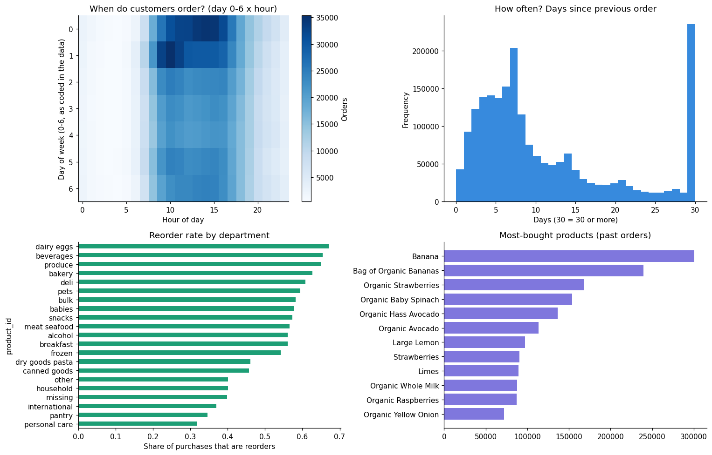
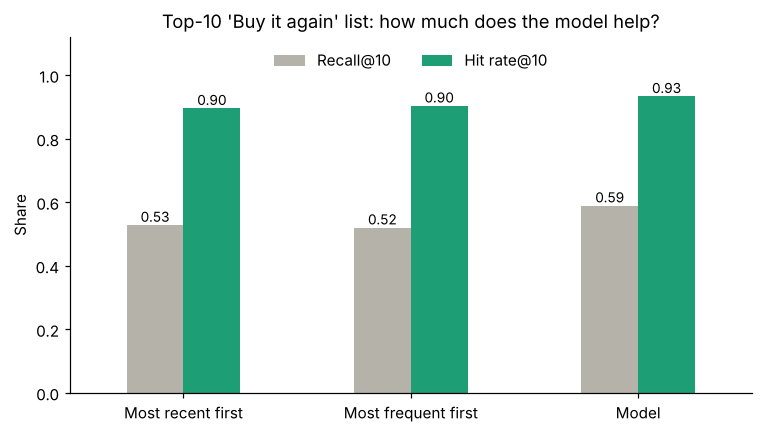
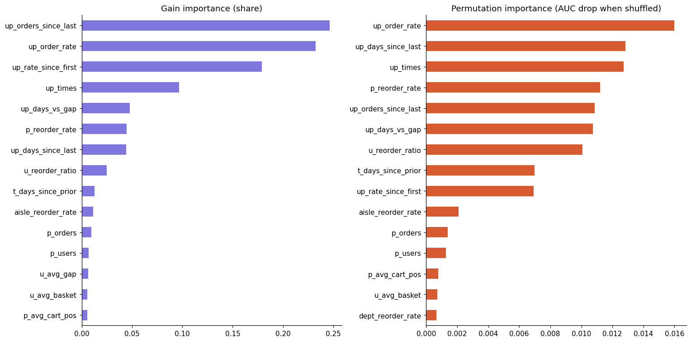

# 🛒 Predicting "Buy it again": Instacart reorder model

**Which products will a grocery customer reorder in their next order?**
A machine-learning model built on 3.4 million real Instacart orders, plus a better top-10 "Buy it again" list.

**Author:** Krish Makhija · **Tools:** Python, pandas, LightGBM, Optuna, scikit-learn

---

## Why it matters
Every grocery app (Instacart, Blinkit, Zepto, Swiggy Instamart) shows a **"Buy it again"** list. When it shows the right products, customers fill their basket faster and come back more. This project predicts reorders for each customer and turns the predictions into a better ranked list.

## Results (test set: 15% of customers, never seen during training or tuning)

Test set: **19,682 customers** and **1.26 million** customer × product pairs.

| Approach | Precision | Recall | F1 | Mean per-order F1 | ROC-AUC | PR-AUC |
|---|---|---|---|---|---|---|
| Baseline: "reorder what was in the last order" | 0.279 | 0.460 | 0.347 | 0.312 | 0.666 | 0.181 |
| **LightGBM (tuned)** | **0.364** | **0.564** | **0.443** | **0.381** | **0.838** | **0.430** |
| *Change* | *+31%* | *+22%* | *+27%* | ***+22%*** | | *2.4×* |

**Top-10 "Buy it again" list**

| Ranking method | Recall@10 | Hit rate@10 |
|---|---|---|
| Most recent first | 0.528 | 0.896 |
| Most frequent first | 0.520 | 0.904 |
| **Model** | **0.589** | **0.934** |

**Key findings**
- **The model beats every simple rule.** Mean per-order F1 rises from 0.312 to 0.381 (+22%), and the top-10 list catches **59%** of the products customers actually reorder, against 53% for the best simple ranking (+6 points).
- **Timing matters almost as much as habit.** The strongest drivers are *how often the customer buys the product* (share of their orders), *how many days since they last bought it*, and *the product's general reorder rate*. Reorders follow a personal cycle, so a "Buy it again" list should be re-ranked by **when** each item is due, not just by what was bought most or most recently.
- **Context:** 58.9% of past purchases are reorders, the median gap between orders is 7 days, and only 9.8% of customer × product pairs are reordered in the next order (heavily imbalanced).





## Approach
1. **Framing:** each row is a *(customer, product they've bought before)* pair. Label = 1 if the product appears in the customer's next order. This is binary classification.
2. **Data used:** the 131,209 customers whose latest order has a known answer. Kaggle's 75,000 "test" orders have hidden answers, so they were excluded.
3. **Split by customer (70 / 15 / 15):** each customer is in exactly one of train, validation or test, so no customer is ever "studied" and then tested.
4. **23 features, built from past orders only.** They describe the customer (habits), the product (popularity, reorder rate, aisle and department rates), the customer × product pair (times bought, recency in orders and days, share of orders), and the order context (day, hour, days since last order).
5. **Baseline first:** "reorder everything from the last order", the bar the model has to clear.
6. **LightGBM + Optuna:** 9 tuning trials on a 30% sample of training customers, scored on validation. The best validation AUC was 0.834, and the final model has 967 trees. `scale_pos_weight` is tuned to handle the imbalanced classes (best: about 3.1).
7. **Threshold chosen on validation** (0.41) to maximise mean per-order F1. The test set is scored **once**.
8. **Business layer:** the top-10 list from the model is compared with "most recent" and "most frequent" rankings.
9. **Explainability:** gain importance plus permutation importance (AUC drop when a feature is shuffled).

## Decisions that protect the results
| Risk | What I did |
|---|---|
| **Target leakage** | No feature uses the basket of the order being predicted. Only day, hour and days-since-last-order, which the app knows in advance, come from that order. |
| **Train-test contamination** | Customers split into separate piles, never rows. Product, aisle and department statistics come from **training customers only**. |
| **Peeking at the test set** | Tuning, early stopping and the threshold all use validation. Test is used once. |
| **Imbalanced classes** | Most pairs are "not reordered", so accuracy isn't reported. The project uses precision, recall, F1, PR-AUC and a tuned class weight instead. |
| **Meaningful missing values** | A customer's first order has no "days since previous order". It's kept as missing, not filled with 0. |

## Limitations
- The data is from **2017** and covers US customers, so habits may have changed since then.
- `days_since_prior_order` is **capped at 30** in the source data.
- Only **reorders** are predicted. Products a customer has never bought aren't candidates.
- No prices are available, so impact is shown in list quality (recall@10), not dollars.
- Tuning ran on a 30% sample of training customers and was stopped after 9 trials to fit Colab's free tier, so a longer search might gain a little more.

## How to run
1. Open `02_instacart_reorder_model.ipynb` in Google Colab.
2. Run all cells. The data downloads automatically through `kagglehub` (public Kaggle copy of Instacart's dataset).
3. Total runtime is about 45–60 minutes on free Colab (the final model alone takes about 15 minutes). Results are saved to `outputs/`. Lower `N_TRIALS` to run faster.

## Data
*The Instacart Online Grocery Shopping Dataset 2017*, released by Instacart for non-commercial use and accessed via Kaggle (`psparks/instacart-market-basket-analysis`).

## Repository
```
├── 02_instacart_reorder_model.ipynb   # full analysis
├── outputs/
│   ├── results.json                    # all metrics
│   └── *.png                           # charts
│   (running the notebook also saves the trained model, lgbm_reorder_model.txt)
├── requirements.txt
└── README.md
```
